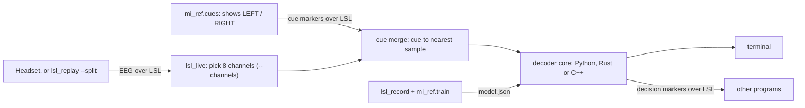

# Real-time motor-imagery BCI decoder

Decodes imagined left versus right hand movement from 8-channel EEG as the samples arrive. The electrode layout is that of the g.tec Unicorn headset used by the Brain-Computer Interface Society at Johns Hopkins (BCIS). The same decoder is written three times against one written contract ([docs/model-format.md](docs/model-format.md)): a Python reference and two native cores, Rust and C++, which make bit-identical decisions.

- **Fast:** about 18 µs per decision (median) in Rust and C++, about 190 µs in Python ([Benchmarks](#benchmarks)).
- **Checked:** 792 Python, 59 Rust and 57 C++ tests. CI runs AddressSanitizer, UndefinedBehaviorSanitizer, fuzzing and Miri, and requires every core to match the reference on synthetic and real public EEG ([docs/ci.md](docs/ci.md)).
- **Live:** reads EEG over Lab Streaming Layer (LSL), merges cues from its own cue program, and publishes each decision as an LSL marker. A recorder and a train command turn a short cued session into a personal model ([docs/lsl-live.md](docs/lsl-live.md)).
- **Honest:** accuracy comes only from cross-validation that holds out whole blocks of trials in time, next to the 95% chance threshold.

## Accuracy, honestly

| Data | People | Above chance | Mean accuracy |
|---|---:|---:|---:|
| PhysioNet EEGMMIDB, cut to the Unicorn's 8 electrode positions | 106 | 56 (about 5 expected by luck) | 64.3% |
| BCIS recordings (Unicorn headset) | 5 | 1 (about 0.25 expected by luck) | 49.7% |

The same pipeline decodes real EEG when the signal is there ([docs/public-data.md](docs/public-data.md)), so the club recordings' near-chance result points at the recordings, not the decoder. Several of their channels sit pinned at the amplifier's limit for most of a session. The engineering numbers above are the headline; the accuracy is reported as measured.

## Try it in five minutes (no headset)

This trains on one person from the public dataset and replays their held-out session as if it came from a headset and a cue program. Person 29 is the best of the 106 (96.7% cross-validated on calibration, 15 of 15 on the held-out run); the typical person is near 64%.

    python3 -m venv .venv && source .venv/bin/activate
    pip install -e "./python[dev,live]"
    python -m mi_ref.eegmmidb --out public-data/eegmmidb --subjects 29
    python -m mi_ref.train public-data/eegmmidb/subject029/session004/S029R04.csv \
        public-data/eegmmidb/subject029/session008/S029R08.csv --fs 160 --out ~/mi-demo/s029.json

Then, in two terminals at the repository root (start the first, then the second within a minute):

    .venv/bin/python -m mi_ref.lsl_live ~/mi-demo/s029.json --channels 0-7 --cue-stream mi-realtime-cues --timeout 60
    .venv/bin/python -m mi_ref.lsl_replay ~/mi-demo/s029.json public-data/eegmmidb/subject029/session012/S029R12.csv --name Unicorn --split mi-realtime-cues

A decision appears about every 8 seconds, for example `sample=992 trial=1 true_label=1 label=1 ...` (1 = left, 2 = right). Add `--core rust` or `--core cpp` once a native core is built (below).

## How it works

Each decision filters the 8 channels into four frequency bands with causal filters, takes a 2-second window starting 0.5 s after an imagery cue, projects it with common spatial patterns (CSP), and classifies the log-variance features with linear discriminant analysis (LDA). The contract fixes the order of every floating-point operation, which is why Rust and C++ agree bit for bit ([docs/rust-vs-cpp.md](docs/rust-vs-cpp.md) compares the two).

## Privacy

Recordings of BCIS members never enter this repository. A pre-commit hook and a CI check refuse data files, and a release test refuses private paths and personal addresses. Everything in `golden/` is synthetic; public data is downloaded on demand (`public-data/` is git-ignored). Club results appear only as aggregate numbers, and the recorder and train commands refuse to write inside the repository.

## Credits and licence

- Recordings and protocol: the Brain-Computer Interface Society at Johns Hopkins.
- Public data: Schalk et al., "BCI2000: a general-purpose brain-computer interface (BCI) system", IEEE Trans. Biomed. Eng. 51(6), 2004, and Goldberger et al., "PhysioBank, PhysioToolkit, and PhysioNet", Circulation 101(23), 2000, under the Open Data Commons Attribution licence v1.0.
- Code: MIT licence ([LICENSE](LICENSE)).

## Development setup

    python3 -m venv .venv && source .venv/bin/activate
    pip install -e "./python[dev,live]"      # includes maturin for the Rust core below
    git config core.hooksPath scripts/hooks   # turns on the data guard (once per clone)
    scripts/test_hooks.sh                     # proves the guard blocks data
    cd python && pytest

## Rust core

`rust/mi_core` is the inference-only Rust core. It reads `model.json`, decodes sample by sample, and is tested against the same `golden/` files and every invalid input in `golden/invalid/`. Measured on the goldens, it matches the Python reference to 5.9e-15 relative on features (the contract allows 1e-9), and it matches the C++ core bit for bit.

    cd rust/mi_core
    cargo test                                   # unit, golden, invalid-input and property tests
    cargo clippy --all-targets -- -D warnings
    cargo fmt --check
    source ../../.venv/bin/activate
    env -u CONDA_PREFIX maturin develop --release   # builds `import mi_core` into .venv
    cd ../../python && pytest                    # now also runs the parity tests for every built core

`env -u CONDA_PREFIX` matters when a conda base environment is active: otherwise maturin installs into conda instead of `.venv`.

Run the Rust tests without features (plain `cargo test`): with `--features python` the extension-module setting leaves libpython unlinked, so `cargo test --features python` fails to link on macOS. The bindings are tested from Python instead. The parity tests skip a core that is not built; set `REQUIRE_CORES=mi_core,mi_core_cpp` to make a missing build an error (for CI).

## C++ core

`cpp/` is the inference-only C++20 core: the same contract, the same golden and invalid-input fixtures, bit-identical decisions to the Rust core. Needs CMake 3.25+, Ninja (`brew install cmake ninja`) and a C++ library with `std::from_chars` for floating point, which the CSV reader uses to parse each value to the correctly rounded double: on macOS that means Xcode 26 (Apple clang 17) or newer, since Xcode 16's libc++ lacks it; on Linux, GCC's libstdc++ 11 or newer. CMake fetches nlohmann/json and GoogleTest at pinned versions (SHA-256 checked), and the `release` preset also fetches Google Benchmark for the micro-benchmarks; pybind11 and scikit-build-core come from pip when the bindings are built.

    cd cpp
    cmake --preset dev && cmake --build --preset dev && ctest --preset dev
    cmake --preset ubsan && cmake --build --preset ubsan && ctest --preset ubsan   # undefined behavior + container bounds checks
    cmake --preset asan && cmake --build --preset asan && ctest --preset asan      # memory checks, Linux only (see below)

Then, from the repo root with `.venv` active, build the Python bindings (`import mi_core_cpp`). With conda base active, use the venv's pip explicitly:

    .venv/bin/pip install ./cpp

Everything compiles with `-ffp-contract=off` (no fused multiply-add) and `-Werror`. The `ubsan` preset is the sanitizer gate on every platform: it also turns on the standard library's bounds checks (libc++ hardening, `_GLIBCXX_ASSERTIONS`), so an out-of-range index into a vector, span or string aborts the test. The `asan` preset (AddressSanitizer: use-after-free, heap overflow, leaks) is available on Linux only. On this project's macOS setup the ASan test binary hangs at startup before any test runs, both in a normal terminal and in a sandboxed shell, so CMake hides the preset there; run it on a Linux machine or in Linux CI.

## Benchmarks

Each implementation has a replay command that streams a recording through its decoder and times every decision; `docs/replay.md` defines the interface and the timing loop. Build the native commands in release mode, then run the benchmark from `python/` with `.venv` active:

    (cd rust/mi_core && cargo build --release --bin mi-replay)
    (cd cpp && cmake --preset release && cmake --build --preset release)
    cd python && python -m mi_ref.bench --readme ../README.md   # about 6 minutes; --modes fast skips the paced runs

The table below is that command's output. It checks that all three made the same decisions before reporting any timing. Micro-benchmarks: `cargo bench` in `rust/mi_core`, `./build/release/mi_core_bench` in `cpp/`.

<!-- bench:start -->
Replay of `stream.csv` (23,000 samples at 250 Hz) on Apple M4, Darwin 25.6.0, from `python -m mi_ref.bench`.
**fast**: one sample at a time, as fast as possible, the recording played 20 times; latency is the time `push` takes on a sample that completes a decision. Samples/s counts the whole loop, which also reads the clock once per sample.
**paced**: 25-sample chunks delivered at 250 Hz, played once, so the decoder idles between chunks; latency runs from a chunk's handover to its decision (see docs/replay.md). 8 of 8 decisions fall on the last sample of their chunk, so their latency includes pushing the whole chunk.
p99 reads n/a below 100 decisions, where it would only repeat the maximum.

| Implementation | Mode | Decisions | p50 (µs) | p99 (µs) | max (µs) | Samples/s | Peak RSS (MiB) |
|---|---|---:|---:|---:|---:|---:|---:|
| Python (reference) | fast | 160 | 193.9 | 888.1 | 3993.0 | 15,233 | 108.3 |
| Rust | fast | 160 | 18.1 | 35.2 | 552.5 | 6,844,831 | 7.7 |
| C++ | fast | 160 | 18.5 | 103.9 | 109.2 | 7,552,178 | 11.7 |
| Python (reference) | paced | 8 | 4643.5 | n/a | 8936.3 | n/a | 105.4 |
| Rust | paced | 8 | 131.9 | n/a | 145.1 | n/a | 7.6 |
| C++ | paced | 8 | 61.9 | n/a | 160.8 | n/a | 11.7 |
<!-- bench:end -->

To time a real recording, pass `--csv /path/outside/repo/file.csv` and keep the output in `results-local/`. `--readme` refuses anything outside `golden/`.

## Evaluate on local recordings

Keep raw data outside the repo, laid out as `subject*/session*/*.csv` (club CSV layout; zero-pad session numbers, e.g. `session001`, so they sort in time order). Results go to the gitignored `results-local/`:

    cd python
    mkdir -p ../results-local
    python -m mi_ref.evaluate --data-dir /path/outside/repo | tee ../results-local/baseline.txt

Some club channels sit pinned near the amplifier's limit for most of a session, where they carry no EEG. `--exclude-pinned RAIL` drops, per subject, every channel at or beyond `RAIL` (raw units) in at least half of its samples, without looking at labels, and fits on the rest (a subject left with fewer than 4 channels is skipped):

    python -m mi_ref.evaluate --data-dir /path/outside/repo --exclude-pinned 700000 | tee ../results-local/exclude-pinned.txt

On the club recordings this leaves one of five subjects with too few channels to fit and moves no subject across its chance threshold: dropping stuck channels does not rescue accuracy. The headset's input range is ±750 mV (Unicorn Hybrid Black manual); stuck channels settle at 95 to 96% of that, and 700000 is 93%. Live, a model with `rail_abs` refuses (label 0, with the channels named in `pinned`) any decision whose window has a used channel at the rail on every sample, rather than guessing (contract step 7).

## Live LSL inlet

Python receives the EEG stream through LSL and can send samples to the Python, Rust, or C++ decoder. `--channels` picks the 8 EEG channels out of a headset stream, and `--cue-stream` merges cues from a separate marker stream, such as the one `python -m mi_ref.cues` publishes while it shows the wearer left/right trials. `mi_ref.lsl_record` and `mi_ref.train` turn a cued session into a personal model (outside the repo). Fake streams let every test run without the club headset. Setup, demos, cue timing and the calibration walkthrough: [docs/lsl-live.md](docs/lsl-live.md).

## Public data: does the pipeline decode real EEG?

Yes. On the public PhysioNet EEG Motor Movement/Imagery Database, cut down to the club headset's 8 electrode positions and run through the unchanged pipeline, 56 of 106 people decode imagined left vs right fist above chance (about 5 expected by luck; mean 64.3%), against 1 of 5 on the club recordings. The same data gives the cores their first real-EEG parity test (Rust and C++ bit-identical, within 1.1e-15 of Python), at 160 Hz instead of 250. Fetching, conversion, attribution and the full results: [docs/public-data.md](docs/public-data.md).

    cd python
    python -m mi_ref.eegmmidb --out ../public-data/eegmmidb     # ~570 MB of CSV, git-ignored
    python -m mi_ref.evaluate --data-dir ../public-data/eegmmidb --fs 160 --min-trials 10

## Regenerate the golden vectors

`golden/` is the contract the native cores test against. Regenerate only on purpose, review the diff, and commit it with the code change that required it:

    cd python && python -m mi_ref.golden && python -m mi_ref.invalid   # the invalid fixtures derive from the golden model

## Continuous integration

GitHub Actions (`.github/workflows/ci.yml`) runs the data guard, every Rust, C++ and Python test, ASan and UBSan, Miri and a 60-second fuzz smoke test per target on Ubuntu for every push to `main` and every pull request, and the macOS build and tests alongside it. [docs/ci.md](docs/ci.md) lists what each step proves, how to run the fuzzers and Miri locally, what to do with a crash, and what a run costs.

## Lessons learned

**A sanitizer found a bug two compilers and three test builds missed (2026-11-09).** The first CI run failed one C++ test under AddressSanitizer with a heap-use-after-free. The test looped over `test::read_json("invalid/manifest.json")["streams"]`: `read_json` returns a temporary, `["streams"]` returns a reference into it, and in C++20 the temporary is destroyed before the loop body runs, so the loop read freed memory. C++23 extends the temporary's lifetime here; C++20 does not.

- It passed on the Mac in the debug, UBSan and release builds, because the freed memory still held the old bytes. Only ASan on Linux (it hangs at startup on macOS) checks every read against freed memory.
- It sat in test code, not the decoder, but it would have hidden a real failure: a test that reads garbage can pass for the wrong reason.
- The fix names the manifest before the loop (`cpp/tests/test_invalid_streams.cpp`). A search found no other loop over a temporary's member.
- Rust's borrow checker refuses to compile the same pattern, so the Rust core cannot contain this class of bug.

The lesson: a green local run on one platform is not proof of memory safety. Run the sanitizers where they work, which is why CI runs ASan on Linux for every pull request.

## Known limitations

- The chance threshold treats trials as independent; trials inside a calibration block are correlated, so a narrow pass is weak evidence. With N subjects, about 0.05 x N pass by luck alone.
- Sessions of one subject are pooled; there is no leave-one-session-out evaluation yet.
- The public-data control drops EEGMMIDB's 128 Hz recordings (people 88, 92, 100) instead of resampling them.
- The live path is tested with simulated headset streams and public EEG; a session with the real Unicorn headset is still to come (checklist in docs/lsl-live.md).
- There is no test for a label-correlated drift inside the 8-30 Hz band.
- The pinned-channel check refuses only a window where a channel is at the rail on every sample; a channel that dips below the rail even once still decides, however wild its values.
