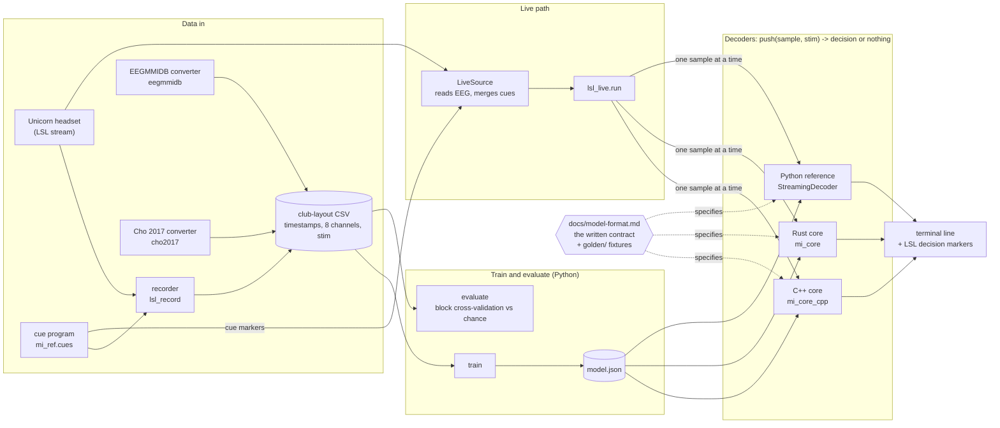
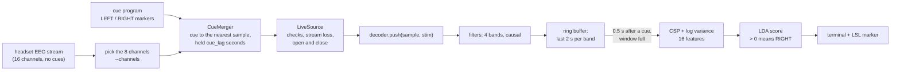
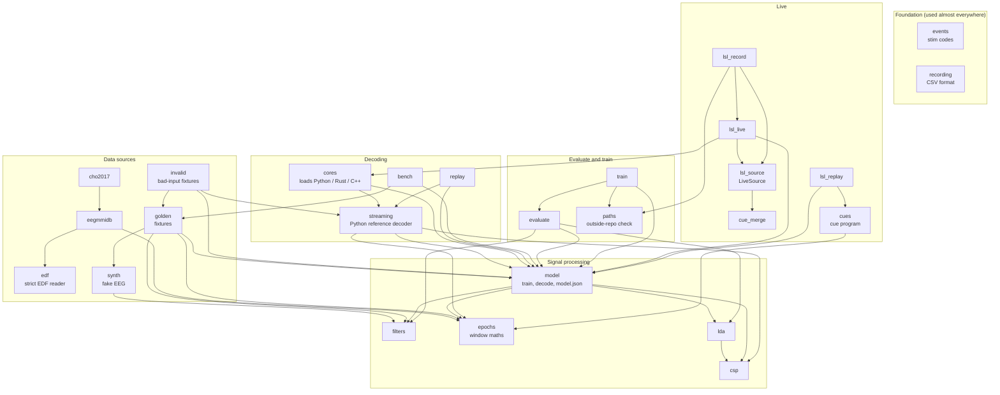
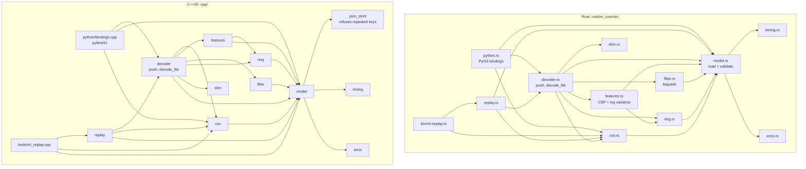
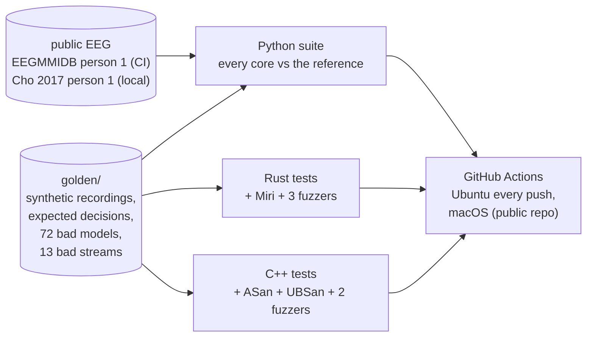

# Architecture and module map

Drawn from the code's imports. Arrows point from a module to the module it uses.

## 1. Overall architecture

Four parts, all meeting at one written contract:
- **Data in:** the club headset live, recordings, and two public datasets.
- **Training and evaluation:** turns recordings into a `model.json`.
- **Three decoders:** each makes the same decisions from that model.
- **Checks:** prove the three decoders agree.

## 2. The live path, step by step

## 3. Python module map (`python/mi_ref`)

`events` (stim-code rules) and `recording` (the CSV format) are the foundation; almost every module uses them, so those arrows are left out.

`cho2017` uses `eegmmidb` only for its download, checksum-file and subject-range helpers.

## 4. Native cores (Rust and C++)

The two cores split the work the same way, file for file, because both follow the same contract. Each has a small public interface:
- load and check a model;
- `push` one sample;
- `decode_file`.

Each also has Python bindings and a `replay` command.

The one structural difference is `json_strict` in C++. The C++ JSON library quietly keeps the last of two repeated keys, while Rust's refuses them, so C++ needs its own check to keep the contract.

## 5. How the checks fit around it

